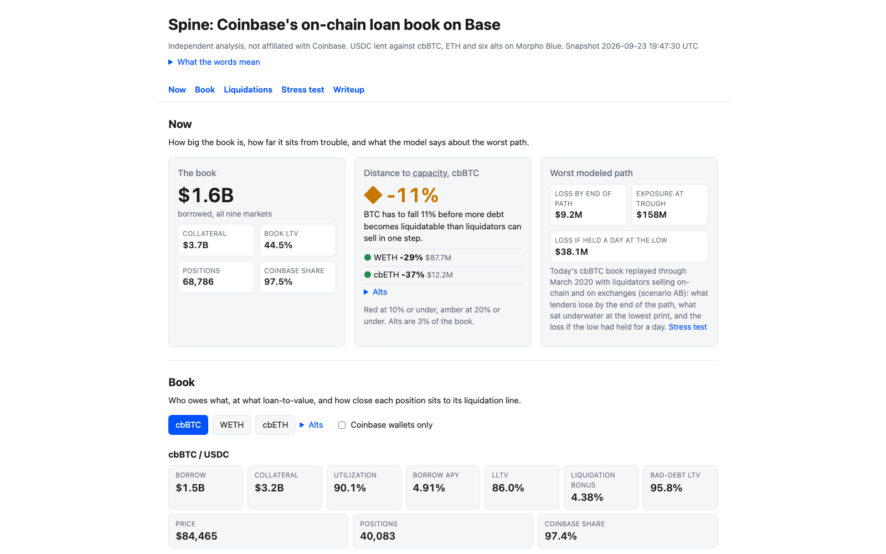

# Spine: liquidator capital, not the LLTV, binds when Coinbase's Morpho loan book meets a fast crash

[](https://github.com/RahilBhavan/spine/actions/workflows/ci.yml)
[](https://github.com/RahilBhavan/spine/actions/workflows/refresh.yml)
[](LICENSE)

**Live:** https://spine.rahilbhavan.com

[](https://spine.rahilbhavan.com/site/)

Spine is a risk dashboard and liquidation backtest for the nine Morpho Blue markets on Base that fund the USDC loans in Coinbase's app. Python fetchers read positions, liquidations, Chainlink oracle updates, Coinbase 5-minute candles and CEX and DEX depth from public endpoints. The pipeline writes `data/summary.json` for a static dashboard. A numpy backtest replays rebuilt historical loan books through seven crash paths and recommends a liquidation LTV (LLTV) and maximum draw for each collateral.

## Reading the dashboard

The first screen summarizes observed borrowing, the selected market’s modeled capacity threshold, and its worst replay loss, with trough exposure shown separately. Daily comparisons use a saved snapshot near 24 hours before the displayed book and print both timestamps; stale or missing data is labeled explicitly. One market selection carries through a sortable/filterable nine-market watchlist, an exact-sample price-shock inspector, positions, liquidation charts, crash replays and supplier exposure. The URL preserves the investigation state and supports back/forward navigation. System/light/dark theme persists locally, and the view can be copied as a link.

Stress results identify their saved book, assumptions and held-out calibration limits. The [UI improvement loop](tools/uiloop/README.md) requires working charts, screenshots and a recorded reader check before accepting a candidate. [Workstation implementation and verification record](docs/ui-workstation-review.md). The [blue graph refinement](docs/graph-review.md) adds stable matrix scales, phone-readable labels, explicit log views, source summaries and color-vision proof captures.

## Results

The headline: on a March 2020 path, losses depend on how much capital liquidators can deploy in a day. Cutting the haircut or the LLTV changes little.

- **Book.** $1.63B borrowed against $3.66B of collateral across 68,772 positions in nine markets. Coinbase Smart Wallets hold 97.5% of the borrowing. Source: `data/summary.json`, snapshot 2026-09-23 19:05 UTC. The live site shows current figures.
- **Track record.** The cbBTC market cleared $256M of liquidations in the four stress weeks of three events (Oct 2025, Feb 2026, Jun 2026) with zero bad debt. Source: `WRITEUP.md`.
- **Calibration.** The borrower-response parameters (70% responsive, two-hour reaction) were fitted on three cbBTC events, where the model reproduces realized liquidation volume at 0.85–0.99x (Oct 2025 0.95x, Feb 2026 0.99x, Jun 2026 0.85x). On five more cbBTC events chosen by a fixed rule (every UTC day with over $5M repaid, since launch) and kept out of the fit, it gives 0.42x to 1.08x (Oct 2025a 0.52x, Nov 2025 1.02x, Nov 2025a 1.08x, Jan 2026 0.77x, Jun 2026b 0.42x). Across all eight events the range is 0.42–1.08x, so the model is not within 15% across events. Held-out WETH events come in at 1.58x and 0.85x. Source: `data/backtest.json`, key `calibrated.ratios`; method in [WRITEUP.md](WRITEUP.md) section 3.
- **Stress replay.** 5,562 saved backtest runs over seven crash windows at 5-minute resolution. Source: `data/backtest.json` and `data/prices/index.json`.
- **Replay book.** The replay ran on the cbBTC/USDC market's loan book as of 2026-09-19, the date of `WRITEUP.md` (`latest_book` in `data/backtest.json`). All percentages of supply below are of that book's $1.58B of USDC supplied. The Book figures above are a different, later snapshot (2026-09-23, all nine markets).
- **March 2020 at today's 86% LLTV, loss by end of path.** $9.2M (0.6% of supply) realized, because BTC bounced and the queue was served above water on the way back up. Source: `WRITEUP.md`.
- **March 2020 at today's 86% LLTV, supply left unserved at the trough.** $158.4M (10.0% of supply) sat underwater with no liquidator able to act at the lowest print. This is a separate measure, taken at a different moment. A 77% LLTV leaves 8.4% unserved. Tripled liquidator capital leaves 6.2%. Source: `WRITEUP.md`.
- **March 2020 with a Coinbase backstop liquidator.** $0 left unserved and $13.1M (0.8%) realized loss. Source: `WRITEUP.md`.

Recommended parameters, from [WRITEUP.md](WRITEUP.md):

| Collateral | Today (LLTV / max draw) | Recommended | Why |
|---|---|---|---|
| cbBTC | 86% / 75% | A committed backstop liquidator first, then 80% / 66–70% | Liquidator capital binds on the March 2020 path. At 80% every other path is clean. |
| WETH | 86% / 75% | 77% / 70% | ETH gaps more than the 4.38% liquidation bonus inside five minutes. At 86%, three of seven paths leave bad debt. |
| cbXRP, SOL, cbDOGE, cbADA, cbLTC, JitoSOL | 62.5% / 55% | 62.5%, max draw 47%, per-asset book cap | No on-chain venue on Base, so every seized unit clears through Coinbase's own order book. |

[WRITEUP.md](WRITEUP.md) has the full argument. Its changelog shows how the headline moved as the model was corrected.

## How it works

- Fetchers in `spine/` (`fetch_positions`, `fetch_liquidations`, `tag_coinbase`, `fetch_prices`, `fetch_depth`, `fetch_vaults`, `fetch_markets`, `fetch_oracle`) read the Morpho API, Base RPC, Coinbase Exchange and Chainlink logs. They use only the standard library.
- `spine/summarize.py` writes `data/summary.json`. `site/index.html`, `site/charts.js` and `site/app.js` render it with no build step. The page's loan check reads one address's positions from Morpho's public API in the visitor's browser.
- `spine/calibrate.py` measures liquidator latency, bonus and throughput on the real events. `spine/rebuild_book.py` rebuilds historical books from on-chain events.
- `spine/backtest.py` (numpy) replays books through the crash paths with fitted borrower response and liquidator capacity. `spine/writeup_tables.py` prints the tables in `WRITEUP.md`. `spine/stress_grid.py` writes the crash path x LLTV x liquidator capital grid to `data/stress_grid.csv`.
- `.github/workflows/refresh.yml` is scheduled hourly (GitHub runs it best-effort). It refreshes the data, advances the backtest, publishes to the `data` branch and GitHub Pages, and runs `spine/alert.py`. The alert opens a GitHub issue when any market is within 10% of its liquidation capacity. Vercel serves the `data` branch at the live URL.

[CODEBASE_GUIDE.md](CODEBASE_GUIDE.md) explains the architecture module by module.

## Run it

Prerequisites: Python 3.12 or later and [uv](https://docs.astral.sh/uv/). No API keys. Every endpoint is public.

Install and test:

```bash
uv sync --extra dev
.venv/bin/python -m pytest -q tests
```

The `tests` badge at the top shows the latest result of this command in CI on `main`. `uv.lock` pins the dependencies. The tests run against the frozen snapshot in `data/`, with no network.

Rebuild the dashboard data. The positions files are not committed, so run `fetch_positions` first on a fresh clone. These commands overwrite files in `data/`.

```bash
.venv/bin/python -m spine.fetch_positions      # all positions, 9 markets (3 min 43 s on 2026-10-21)
.venv/bin/python -m spine.fetch_liquidations   # every liquidation (incremental after the first run)
.venv/bin/python -m spine.tag_coinbase         # Coinbase Smart Wallet tags via Multicall3
.venv/bin/python -m spine.fetch_prices         # Coinbase 5-minute candles for 7 crash windows (cached)
.venv/bin/python -m spine.fetch_depth          # CEX L2 depth and DEX quoter capacity
.venv/bin/python -m spine.fetch_vaults         # vaults that fund each market
.venv/bin/python -m spine.fetch_markets        # every Base market over $10M borrowed (market level)
.venv/bin/python -m spine.summarize            # writes data/summary.json
.venv/bin/python -m http.server 8000           # local copy of https://spine.rahilbhavan.com/site/ on port 8000
```

Run the stress-test pipeline. It is slow. `fetch_oracle`, `calibrate`, `rebuild_book` and `backtest` take `--max-seconds N`, save progress to `data/cache/` and resume on the next run.

```bash
.venv/bin/python -m spine.fetch_oracle                   # Chainlink AnswerUpdated paths for the real events
.venv/bin/python -m spine.calibrate                      # realized latency, bonus and throughput
.venv/bin/python -m spine.rebuild_book cbBTC 2026-02-03 2026-06-01 2025-10-09
.venv/bin/python -m spine.backtest calib
.venv/bin/python -m spine.backtest grid --market cbBTC
```

## How this was built

<!-- DRAFT: drafted by an AI agent from the git history and the repo's own docs. Needs Rahil's confirmation before merge. -->

*Draft, pending Rahil's confirmation.*

AI coding agents wrote much of this repository. 80 of the 86 commits not made by the refresh bot carry a `Co-Authored-By: Claude` trailer (Opus 5, Opus 5.5 and Sonnet 5.5 appear in the trailers), and the history includes merges of agent worktree branches. The 43 `spine-bot` commits are hourly data snapshots, not code.

What the repository itself records about the human side:

- Every non-bot commit is under Rahil's git identity, and the roadmap leaves decisions such as posting the outreach drafts to "the owner's call".
- The blue graph palette is recorded as the user's explicit choice in [DESIGN.md](DESIGN.md) and [docs/graph-review.md](docs/graph-review.md).
- The review rules in [CONTRIBUTING.md](CONTRIBUTING.md) require each pull request to paste its acceptance-check output.
- No human reader study has been done. The UI reader checks in [tools/uiloop/LOG.md](tools/uiloop/LOG.md) were done by an agent, and the repo says so.

Rahil to fill in before this ships: which parts of the question, the model, the data choices and the numbers he designed himself, and which results he re-derived or checked by hand. Until then, treat the numbers as agent-produced and script-checked (`pytest`, the `--check` runs and the tables printed from `data/`), not as independently verified by a person.

## Repository layout

- `spine/`: fetchers, summarizer, calibration, book rebuild, backtest, alert and writeup renderer.
- `tests/`: pytest checks for the summarizer, backtest, alert and committed data.
- `data/`: one frozen snapshot of the generated data, so a fresh clone renders and tests pass. The `data` branch holds the latest.
- `site/`: the static dashboard and `writeup.html`, rendered from `WRITEUP.md`.
- `research/`: source sweeps, the self-liquidation check, outreach drafts and `crash_table.py`.
- `docs/`: the dashboard screenshot and the social card.
- `.github/workflows/`: `ci.yml` (tests), `refresh.yml` (hourly data) and `links.yml` (weekly link check).

## Documentation

- [WRITEUP.md](WRITEUP.md): the long-form argument for each haircut, with every table and its changelog.
- [CODEBASE_GUIDE.md](CODEBASE_GUIDE.md): architecture, design choices, a module tour and a reading plan.
- [PLAN.md](PLAN.md): the original specification and recorded decisions, from 2026-09-15.
- [ROADMAP.md](ROADMAP.md): later corrections and unfinished work.
- [CONTRIBUTING.md](CONTRIBUTING.md): the code, data and review rules the repository follows.
- [CHANGELOG.md](CHANGELOG.md): release notes.
- [research/](research/): sources for markets, crashes, depth and prior art.
- [docs/screenshot.png](docs/screenshot.png): the dashboard on 2026-09-23.

## Sources

- Morpho Blue API (`blue-api.morpho.org`) and Base RPC: positions, liquidations, vaults and Coinbase Smart Wallet tags.
- Chainlink `AnswerUpdated` logs on Base: oracle paths for the real stress events.
- Coinbase Exchange: 5-minute candles for seven crash windows from March 2020 to June 2026, and L2 order-book depth.
- Aerodrome and Uniswap quoters on Base: on-chain liquidation capacity.

`main` holds one frozen snapshot from 2026-09-23. The hourly job replaces the `data` branch with a single new commit each run. Every table in `WRITEUP.md` is printed by a script from the files in `data/`. If you reuse the calibration numbers, cite the writeup by date.

## Scope and limits

- Independent analysis from public on-chain data. Not affiliated with or endorsed by Coinbase or Morpho.
- Research, not risk advice. The recommendations are model outputs.
- The borrower-response fit has two parameters on three events. `WRITEUP.md` says this deserves modest confidence.
- Historical order-book depth for the crash windows is the least-known input.
- The busiest liquidation day was not a binding day, so it sets a floor on liquidator capacity, not an estimate.
- Numbers in this README come from the 2026-09-23 snapshot. A fresh fetch gives different live figures.

## License

MIT. See [LICENSE](LICENSE). The license covers this project's code, not third-party data from Morpho, Chainlink or Coinbase.

Part of [Rahil Bhavan's projects](https://github.com/RahilBhavan).
